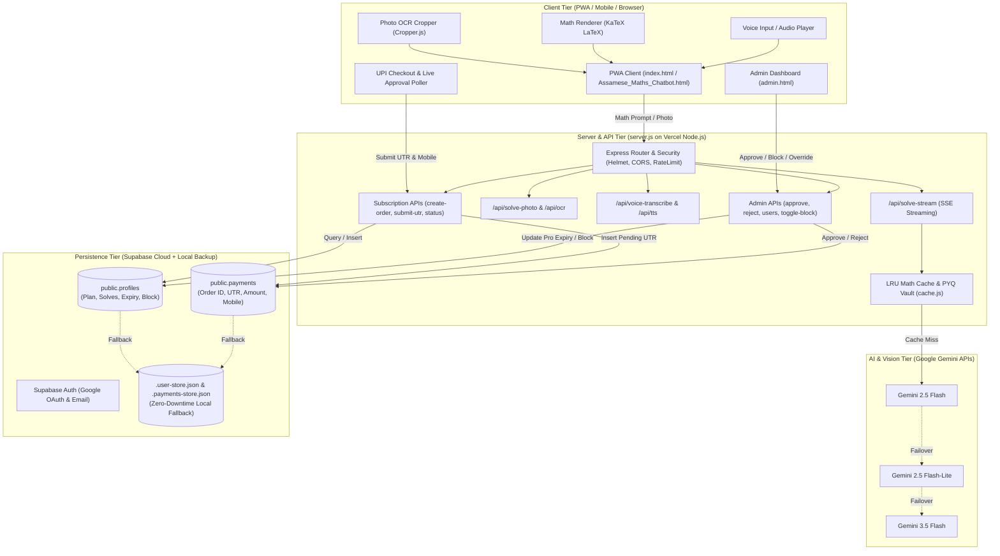

# 📐 Axomগণিত AI (Axomganit Pro) — Enterprise Architecture & API Documentation

> **Commercial-grade, Dual-Lingual (অসমীয়া & English) AI Mathematics Problem Solver & Exam Mentor**  
> Tailored for **Std 1–12 (SEBA / AHSEC / CBSE)** and **Assam Govt Competitive Exams (ADRE Grade III/IV, APSC CCE, Assam Police, TET, Banking, SSC)**.

[](https://axomganit-chatbot.vercel.app)
[](https://axomganit-chatbot.vercel.app/admin)
[](https://nodejs.org/)
[](https://ai.google.dev/)
[](https://supabase.com/)

---

## 📌 Table of Contents
1. [Executive Summary](#-executive-summary)
2. [Live Application URLs & Credentials](#-live-application-urls--credentials)
3. [System Architecture Diagram](#-system-architecture-diagram)
4. [Core Architectural Pillars](#-core-architectural-pillars)
5. [Repository File & Directory Structure](#-repository-file--directory-structure)
6. [Detailed Module & Function Breakdown](#-detailed-module--function-breakdown)
   - [`server.js` (Express Server & AI Gateway)](#1-serverjs-express-server--ai-gateway)
   - [`auth-db.js` (Database, Auth & Subscription Engine)](#2-auth-dbjs-database-auth--subscription-engine)
   - [`cache.js` (Deterministic LRU Math Solution Cache)](#3-cachejs-deterministic-lru-math-solution-cache)
   - [`admin.html` (SaaS Admin Portal)](#4-adminhtml-saas-admin-portal)
   - [`index.html` (Frontend PWA Client)](#5-indexhtml-frontend-pwa-client)
   - [`schema.sql` (Database DDL & Policies)](#6-schemasql-database-ddl--policies)
7. [API Endpoint Reference](#-api-endpoint-reference)
8. [Subscription Plans & Quota Architecture](#-subscription-plans--quota-architecture)
9. [Payment Approval & Fraud Prevention Workflow](#-payment-approval--fraud-prevention-workflow)
10. [Local Development & Environment Setup](#-local-development--environment-setup)
11. [Production Deployment (Vercel)](#-production-deployment-vercel)

---

## 🚀 Executive Summary

**Axomগণিত AI** solves the chronic shortage of native-language (অসমীয়া) STEM learning tools in Northeast India. It functions both as an interactive **step-by-step school tutor** for SEBA/AHSEC board syllabi and a **30-second shortcut trick mentor** for competitive job aspirants.

### Key Capabilities:
- **Streaming Step-by-Step Mathematical Proofs**: Server-Sent Events (SSE) streaming answers formatted in KaTeX ($\LaTeX$), outlining Given Data, Formulas, Step-by-Step Computations, and Self-Verification.
- **Photo OCR Vision Solver**: Allows students to capture handwritten math from notebooks or textbooks with on-canvas cropping (`Cropper.js`), extracting and solving formulas automatically.
- **Voice Q&A**: Multimodal audio transcription and text-to-speech for Assamese speech queries.
- **Curated PYQ Bank & Sub-millisecond Cache**: Instant retrieval of past year questions from SEBA HSLC, AHSEC Class 12, and ADRE examinations.
- **Direct UPI QR Checkout with Admin Approval**: Fraud-resistant payment verification preventing unauthorized access while letting students submit 12-digit UTR reference numbers and WhatsApp contact info.
- **Enterprise Admin SaaS Portal**: Real-time pending approvals, registered student directory, 1-click WhatsApp messaging, account block/unblock, manual plan overrides, and CSV ledger export.

---

## 🌐 Live Application URLs & Credentials

| Service | URL | Notes / Access |
| :--- | :--- | :--- |
| **Student Web Application** | [https://axomganit-chatbot.vercel.app](https://axomganit-chatbot.vercel.app) | Public PWA |
| **Admin Approval Dashboard** | [https://axomganit-chatbot.vercel.app/admin](https://axomganit-chatbot.vercel.app/admin) | **PIN:** `axomadmin2026` |
| **UPI Payee VPA** | `amiete66@okicici` | Payee: **Abu Sazid Ahmed** |
| **Cloud Database** | Supabase (`kskivlhedvcdwohfhywh.supabase.co`) | Managed Postgres |

---

## 🏗️ System Architecture Diagram



---

## 🛡️ Core Architectural Pillars

1. **Multi-Model LLM Resilience**:
   Calls Google Gemini 2.5 Flash as the primary reasoning engine, falling back to Gemini 2.5 Flash-Lite, Gemini 3.5 Flash, or pre-cached canonical textbook vaults in `cache.js` to prevent rate-limit failures.
2. **Stateless Serverless Compatibility with Supabase Cloud**:
   Because Vercel serverless containers are ephemeral and cannot rely on in-memory maps across requests, all subscription states, user quotas, and payment requests reside directly in Supabase Postgres tables (`profiles`, `payments`), synchronized across instances.
3. **Dual Offline & Online Execution**:
   If internet connectivity is completely lost, the browser service worker serves the offline app shell, and client-side rule-based algebraic routines execute offline.
4. **Fraud-Resistant Manual UPI Queue**:
   Avoids reliance on easily spoofed client-side UTR validation. Orders remain `pending` until verified by an administrator via bank SMS or UPI statements.
5. **Numeral Normalization**:
   Assamese digits (`০`, `১`, `২`, `৩`, `৪`, `৫`, `৬`, `৭`, `৮`, `৯`) are automatically mapped to ASCII digits (`0`-`9`) before caching and tokenization, ensuring high cache hit rates and deterministic hash lookups.

---

## 📂 Repository File & Directory Structure

```plaintext
axomganit-chatbot/
├── .env                       # Local environment variables (PORT, Keys, Model, UPI)
├── .env.example               # Example template for environment secrets
├── .gitignore                 # Excludes node_modules, stores, and OS artifacts
├── .payments-store.json       # Local fallback store for offline/ephemeral payments
├── .user-store.json           # Local fallback store for offline/ephemeral profiles
├── .vercel/                   # Vercel deployment link cache
├── admin.html                 # Professional SaaS Admin Dashboard (dark theme)
├── Assamese_Maths_Chatbot.html# Standalone mirror of the frontend student application
├── auth-db.js                 # Database wrapper: Supabase client, quota, plans, CRUD
├── cache.js                   # Deterministic LRU cache and canonical math vault
├── icons/                     # PWA application icons (192x192, 512x512, SVG)
├── index.html                 # Primary student frontend (KaTeX, OCR, Voice, UPI checkout)
├── manifest.json              # PWA web manifest specification
├── package.json               # Node.js dependencies, scripts, and package metadata
├── package-lock.json          # Locked dependency tree
├── pwa-assets.js              # Inline PNG asset generation helper for PWA icons
├── schema.sql                 # Supabase PostgreSQL schema with RLS and trigger functions
├── server.js                  # Main Express backend, streaming endpoints, and APIs
├── service-worker.js          # Service worker for offline asset caching
└── vercel.json                # Vercel serverless routing, headers, and build configuration
```

---

## ⚙️ Detailed Module & Function Breakdown

### 1. `server.js` (Express Server & AI Gateway)

The primary entry point handling HTTP server setup, security middleware, AI orchestration, and RESTful routing.

#### Key Functions & Middleware:
- **`requireAdminAuth(req, res, next)`**:
  Validates the `x-admin-key` header against `process.env.ADMIN_KEY || 'axomadmin2026'`. Rejects unauthorized calls with HTTP 401.
- **`solverRateLimiter`**:
  Configured with `express-rate-limit` allowing 30 requests per minute per IP to prevent API exhaustion while permitting high student engagement.
- **`getSystemPrompt(mode, lang)`**:
  Constructs domain-specific system prompts:
  - `mode === 'competitive'`: Mandates 30-second shortcuts, LCM/ratio tricks, option elimination, and high-yield tips.
  - `mode === 'school'`: Mandates SEBA/AHSEC board exam format (Given Data $\to$ Formulas $\to$ Step-by-Step Proof $\to$ Final Answer $\to$ Verification).
  - `lang`: Controls native Assamese (`as`), fluent English (`en`), or Bilingual (`bilingual`).
- **`callGeminiWithFallback(apiKey, requestBody)`**:
  Iterates through `GEMINI_MODELS = ['gemini-2.5-flash', 'gemini-2.5-flash-lite', 'gemini-3.5-flash', 'gemini-3.5-flash-lite']`, retrying up to 2 times for transient socket disconnects before failing over to the next model.
- **`streamGemini(apiKey, requestBody, onChunk)`**:
  Streams content chunks via `v1beta/models/{model}:streamGenerateContent?alt=sse`. Parses Server-Sent Events line by line and relays candidate text parts to the client.
- **`handleVoiceTranscription(buffer, mimeType, apiKey)`**:
  Sends audio buffer as inline base64 data to Gemini Multimodal, transcribing Assamese speech into text.

---

### 2. `auth-db.js` (Database, Auth & Subscription Engine)

Abstracts Supabase Cloud PostgreSQL and handles user profiles, plan catalogs, quota checks, and payment lifecycles.

#### Catalog Specification (`PLANS`):
```javascript
const PLANS = {
  school_daily:          { amount: 10,  days: 1,   imageLimit: 999999, voiceLimit: 999999 },
  school_monthly_basic:  { amount: 49,  days: 30,  imageLimit: 25,     voiceLimit: 10     },
  school_monthly_pro:    { amount: 99,  days: 30,  imageLimit: 60,     voiceLimit: 30     },
  school_6month:         { amount: 499, days: 180, imageLimit: 60,     voiceLimit: 30     },
  competitive_monthly:   { amount: 99,  days: 30,  imageLimit: 60,     voiceLimit: 30     },
  competitive_3month:    { amount: 249, days: 90,  imageLimit: 60,     voiceLimit: 30     }
};
```

#### Core Class Methods:
- **`getUserProfile(userId)`**:
  Retrieves user metadata from Supabase `profiles` table. If running locally or Supabase is unavailable, fetches from `.user-store.json`.
- **`sanitizeProfile(profile, authUser)`**:
  Computes daily limits (`FREE_DAILY_SOLVE_LIMIT = 2`), remaining questions, Pro status based on `pro_valid_until`, and extracts student mobile from `user_metadata.mobile` or profile columns.
- **`isUserPro(profile)`**:
  Evaluates `Boolean(profile.plan !== 'free' && new Date(profile.pro_valid_until) > new Date())`.
- **`checkUserQuota(userId, userApiKey)`**:
  1. Checks if the student is blocked (`is_blocked === true`). Rejects with HTTP 403.
  2. If the user provides a custom Gemini API Key (BYOK), grants unlimited quota.
  3. If user is active Pro, allows execution.
  4. If free tier, allows execution if `remaining_solves > 0`, otherwise returns `quota_exceeded`.
- **`recordUserSolve(userId)`**:
  Increments the user's `daily_solve_count` and updates `last_solve_date` in Supabase.
- **`upgradeUser(userId, planId, durationDays)`**:
  Computes `newExpiry = now + durationDays` and updates `profiles.plan` and `profiles.pro_valid_until`.
- **`createOrder(userId, planId)`**:
  Generates a unique `orderId` (`AXOM-XXXXX-XXXX`) and constructs a standard `upi://pay` deep-link URL pointing to payee `amiete66@okicici`.
- **`submitUtrForApproval(userId, orderId, utr, planId, email, name, mobile)`**:
  Persists pending record into Supabase `payments` table and saves student mobile number in `auth.admin.updateUserById(user_metadata.mobile)` and `payments.user_email` (`email | Mobile: <mobile>`).
- **`getAdminPayments()`**:
  Async query fetching pending, completed, and rejected orders from Supabase `payments` joined with student names and avatars from `profiles`.
- **`getAdminUsers()`**:
  Async query listing all registered users with their full name, email, mobile, plan badge, solves today, and blocked state.
- **`toggleUserBlock(userId, isBlocked)`**:
  Sets `is_blocked: Boolean` in both Supabase Auth metadata and `profiles` table.
- **`setUserPlanManually(userId, planId, durationDays)`**:
  Enables administrators to grant, extend, or revoke Pro access directly from the admin dashboard.
- **`approvePayment(orderId)`**:
  Marks payment status as `completed`, calculates new plan expiration, and upgrades the student's profile.
- **`rejectPayment(orderId, reason)`**:
  Marks payment status as `rejected` with an attached reason.
- **`checkPaymentStatus(orderId, userId)`**:
  Endpoint polled by the student client to detect when an administrator approves their payment.

---

### 3. `cache.js` (Deterministic LRU Math Solution Cache)

Drastically minimizes API token costs and ensures instantaneous loading for standard textbook problems.

#### Core Class Methods:
- **`normalizePrompt(text)`**:
  Converts Assamese numerals (`০-৯`) to Western digits (`0-9`), strips Assamese and English punctuation (`।`, `?`, `!`, `,`), collapses spaces, and lowercases.
- **`generateKey(prompt, mode, lang, imageBase64)`**:
  Generates an MD5 hash over normalized inputs to provide deterministic cache keys (`txt:<hash>:<mode>:<lang>` or `img:<hash>:<mode>:<lang>`).
- **`get(prompt, mode, lang, imageBase64)`**:
  Performs LRU lookup with TTL verification. If exact key is not found, executes a fuzzy match against the canonical textbook PYQ vault.
- **`set(prompt, mode, lang, solution, model, imageBase64, ttlMs)`**:
  Inserts solution into the map, evicting the least recently used entry if `maxSize` (default: 1000) is exceeded.
- **`setVault(question, mode, lang, solution, model)`**:
  Pre-seeds canonical previous year questions (e.g., AHSEC calculus, SEBA quadratic equations, ADRE LCM shortcuts) into memory at startup.

---

### 4. `admin.html` (SaaS Admin Portal)

A modern dark-slate administrative dashboard built with native JavaScript and responsive CSS.

#### Architectural Features:
- **Authentication**: Gate-kept by PIN (`axomadmin2026`) stored in `sessionStorage` and transmitted in `x-admin-key`.
- **KPI Metrics Ribbon**: Shows live counts for Pending Approvals, Total Registered Students, Active Pro Subscribers, and Gross Collected Revenue (₹).
- **Tab 1: ⏳ অনুমোদন বাকী (Pending Approvals Queue)**:
  - Displays Order ID, timestamp, student name, email, and mobile number.
  - 1-click **WhatsApp Chat link** (`https://wa.me/91<mobile>?text=...`) and direct call link.
  - Large monospace UTR badge with a 1-click copy button.
  - **✓ Approve** and **✕ Reject** buttons with instant table updates.
- **Tab 2: 👥 ছাত্ৰ-ছাত্ৰী পৰিচালনা (User Management Directory)**:
  - Search filter across names, emails, and mobile numbers.
  - Category filters: All, Pro Only, Free, Blocked.
  - 1-click **🚫 Block / ✅ Unblock** toggle.
  - **👑 Pro দিয়ক (Grant Pro)** modal for manual plan assignment (1 to 365 days).
- **Tab 3: 📜 লেনদেনৰ ইতিহাস (Transaction History)**:
  - Full archive of completed and rejected transactions.
  - **📥 CSV Export button**: Generates and downloads `axomganit_transactions.csv`.
- **Auto-Refresh Daemon**: Periodically refreshes queues every 12 seconds in the background.

---

### 5. `index.html` (Frontend PWA Client)

The commercial frontend interface designed for students across Assam.

#### Architectural Features:
- **Real-Time KaTeX Rendering**: Equations enclosed in `$$...$$` or `$...$` are converted into crisp vector typography.
- **On-Canvas Cropping Tool**: Uses `Cropper.js` to let students frame specific math problems from camera photos or textbook screenshots.
- **Category-Based Checkout Modal**:
  - Segmented toggle between **🏫 বিদ্যালয় (Std 1–12)** and **🎯 চাকৰি প্ৰাৰ্থী (ADRE / APSC)**.
  - Prominently displays daily quotas (2 free/day for free users, 25 or 60 photos, 10 or 30 voice notes).
  - Generates dynamic QR codes and mobile UPI intent buttons (`mobileUpiIntentBtn`).
  - Validates 10-digit mobile number and 12-digit UTR before submission.
  - Polls `/api/subscription/status` every 6 seconds until approval is granted.
- **Voice Input**: Integrates Web Speech API and backend Gemini audio transcription.
- **PWA Service Worker**: Installs to home screens with full offline capability.

---

### 6. `schema.sql` (Database DDL & Policies)

PostgreSQL schema executed in Supabase:
- **`public.profiles`**: Contains student IDs, email, display name, avatar, subscription plan, Pro expiration timestamp, daily solve counter, last solve date, and block flag.
- **`public.payments`**: Contains payment records, order IDs, UTRs, amount, status, user ID, and mobile contact info.
- **Row Level Security (RLS)**: Enforces policies so students can only view their own records, while `service_role` has full administrative access.
- **Auth Trigger (`handle_new_user`)**: Listens to `auth.users` insertions on Google OAuth sign-in and automatically provisions a corresponding record in `public.profiles`.

---

## 📡 API Endpoint Reference

### Public & Student Endpoints

| Method | Endpoint | Description | Request Body / Query | Response |
| :--- | :--- | :--- | :--- | :--- |
| `GET` | `/api/health` | Service health status | None | `{ status: "ok", uptime, hasServerApiKey }` |
| `GET` | `/api/config` | Client configuration | None | `{ supabaseUrl, supabaseAnonKey, payeeUpi, payeeName }` |
| `GET` | `/api/pyqs` | Previous year questions | `?category=adre&lang=as` | `{ success: true, count, pyqs: [...] }` |
| `POST` | `/api/solve-stream` | SSE streaming math solver | `{ prompt, imageBase64, mode, lang }` | Server-Sent Events stream (`data: {"chunk":"..."}`) |
| `POST` | `/api/solve` | Buffered JSON math solver | `{ prompt, imageBase64, mode, lang }` | `{ solution, model, cached }` |
| `POST` | `/api/ocr` | Photo formula OCR | `{ imageBase64, mimeType }` | `{ text, formulas: [...] }` |
| `POST` | `/api/voice-transcribe` | Audio speech-to-text | `{ audioBase64, mimeType }` | `{ text }` |
| `GET` | `/api/user/profile` | Retrieve student quota & plan | Header: `x-user-id` | `{ success: true, profile: {...} }` |
| `GET` | `/api/subscription/plans` | Fetch available plans | None | `{ success: true, plans: {...} }` |
| `POST` | `/api/subscription/create-order` | Generate UPI order & QR | `{ planId }` | `{ success: true, orderId, upiUrl, amount }` |
| `POST` | `/api/subscription/submit-utr` | Submit UTR for review | `{ orderId, utr, planId, mobile, email }` | `{ success: true, status: "pending", message }` |
| `GET` | `/api/subscription/status` | Poll payment status | `?orderId=AXOM-XXXX` | `{ status: "pending"\|"completed", isPro }` |

### Admin Endpoints (Require Header `x-admin-key: axomadmin2026`)

| Method | Endpoint | Description | Request Body | Response |
| :--- | :--- | :--- | :--- | :--- |
| `GET` | `/api/admin/payments` | Fetch all pending & past orders | None | `{ success: true, pending: [...], completed: [...], stats: {...} }` |
| `GET` | `/api/admin/users` | List all registered students | None | `{ success: true, totalUsers, users: [...] }` |
| `POST` | `/api/admin/approve` | Approve payment & grant Pro | `{ orderId }` | `{ success: true, message }` |
| `POST` | `/api/admin/reject` | Reject invalid UTR | `{ orderId, reason }` | `{ success: true, message }` |
| `POST` | `/api/admin/user/toggle-block`| Block / Unblock user | `{ userId, isBlocked }` | `{ success: true, is_blocked, message }` |
| `POST` | `/api/admin/user/set-plan` | Manually assign / extend plan | `{ userId, planId, durationDays }` | `{ success: true, profile, message }` |

---

## 💎 Subscription Plans & Quota Architecture

### Free Tier vs. Pro Tiers

| Parameter | 🆓 Free Tier | 👑 Pro Tiers |
| :--- | :---: | :---: |
| **Daily Solves** | **2 solves / day** (Resets at 00:00) | **Unlimited** ($\infty$) |
| **Photo Uploads** | 2 / day | Up to 60 / day |
| **Voice Input / Output** | 2 / day | Up to 30 / day |
| **Exam Modes** | Basic School Mode | SEBA + ADRE 30-sec Shortcut Tricks |
| **PDF Worksheets** | With Watermark | Clean, Print-Ready PDF |
| **Server Priority** | Standard | High-Speed Priority Stream |

### Current Plan Catalog

#### 🏫 Category 1: School Students (Std 1–12)
1. **⚡ দৈনিক পাছ (1-Day Pass) — ₹১০ / ২৪ ঘণ্টা**: All Pro features unlimited for exam eve.
2. **🎓 ছাত্ৰ মাহেকীয়া বেচিক — ₹৪৯ / ৩০ দিন**: 25 daily photo uploads, 10 daily voice notes.
3. **👑 ছাত্ৰ মাহেকীয়া প্ৰিমিয়াম — ₹৯৯ / ৩০ দিন**: 60 daily photo uploads, 30 daily voice notes, clean PDF worksheets.
4. **🌟 ছাত্ৰ ৬-মহীয়া পাছ — ₹৪৯৯ / ১৮০ দিন**: 60 daily photo uploads, 30 daily voice notes, complete board prep.

#### 🎯 Category 2: Competitive Exams (ADRE / APSC / TET / Assam Police)
1. **🎯 মাহেকীয়া Pro পাছ — ₹৯৯ / ৩০ দিন**: All Pro features + 30-sec shortcuts, 60 daily photos, 30 daily voice notes.
2. **💎 ৩-মহীয়া ক্ৰাশ্ব কোৰ্চ — ₹২৪৯ / ৯০ দিন**: All Pro features + option elimination tricks, 60 daily photos, 30 daily voice notes, full PYQ bank.

---

## 🔐 Payment Approval & Fraud Prevention Workflow

```plaintext
1. Student clicks plan on Web App
   └── App calls POST /api/subscription/create-order
   └── Server generates orderId: AXOM-MVXXXX-XXXX and dynamic UPI link for amiete66@okicici

2. Student scans QR with GPay / PhonePe / Paytm / BHIM
   └── Student sends ₹49 / ₹99 / ₹249
   └── Banking app generates 12-digit UPI Reference No. (UTR)

3. Student enters WhatsApp Mobile No. & 12-Digit UTR
   └── App calls POST /api/subscription/submit-utr
   └── Supabase stores record in public.payments with status = 'pending'
   └── App starts live polling GET /api/subscription/status every 6s

4. Admin opens /admin Portal (PIN: axomadmin2026)
   └── Order appears in "⏳ অনুমোদন বাকী" with student name, mobile, and UTR
   └── Admin cross-references bank notification / statement
   └── Admin clicks "✓ Approve" (or "💬 WhatsApp" to contact student)

5. Server updates database
   └── payments.status = 'completed'
   └── profiles.plan = selected_plan, profiles.pro_valid_until = now + duration
   └── Student's browser polling receives status = 'completed'
   └── Student app immediately congratulates and unlocks Pro features
```

---

## 💻 Local Development & Environment Setup

### 1. Prerequisites
- **Node.js**: v18.0.0 or higher
- **npm**: v9.0.0 or higher
- **Git**

### 2. Clone and Install Dependencies
```bash
git clone https://github.com/abusazid46-tech/axomganit-chatbot.git
cd axomganit-chatbot
npm install
```

### 3. Configure Environment Variables (`.env`)
Create a `.env` file in the root directory:
```env
PORT=3000
GEMINI_API_KEY=your_google_gemini_api_key_here
GEMINI_MODEL=gemini-2.5-flash
SUPABASE_URL=https://kskivlhedvcdwohfhywh.supabase.co
SUPABASE_ANON_KEY=your_supabase_anon_key
SUPABASE_SERVICE_ROLE_KEY=your_supabase_service_role_key
PAYEE_UPI_ID=amiete66@okicici
PAYEE_NAME=Abu Sazid Ahmed
ADMIN_KEY=axomadmin2026
```

### 4. Database Setup
Log in to your Supabase project dashboard, open the **SQL Editor**, paste the contents of [`schema.sql`](schema.sql), and execute.

### 5. Launch Local Development Server
```bash
npm start
```
The application will be accessible at `http://localhost:3000` and the Admin Portal at `http://localhost:3000/admin`.

---

## 🚀 Production Deployment (Vercel)

The application is optimized for zero-config serverless deployment on Vercel:

1. **Push commits to GitHub**:
   ```bash
   git add .
   git commit -m "feat: updates"
   git push origin main
   ```
2. **Deploy via Vercel CLI**:
   ```bash
   npx vercel --prod --yes
   ```
3. **Configure Vercel Environment Variables**:
   In the Vercel Project Settings (or via CLI `npx vercel env add`):
   - `GEMINI_API_KEY`: Google Gemini API Key
   - `GEMINI_MODEL`: `gemini-2.5-flash`
   - `SUPABASE_URL`: Supabase project URL
   - `SUPABASE_ANON_KEY`: Supabase anon public key
   - `SUPABASE_SERVICE_ROLE_KEY`: Supabase service role secret
   - `PAYEE_UPI_ID`: `amiete66@okicici`
   - `PAYEE_NAME`: `Abu Sazid Ahmed`
   - `ADMIN_KEY`: `axomadmin2026`

---

## 👨‍💻 Maintainer & Author

- **Founder & Developer**: Abu Sazid Ahmed
- **Contact & Support**: `abusazid46@gmail.com`
- **UPI Support**: `amiete66@okicici`
- **Repository**: [https://github.com/abusazid46-tech/axomganit-chatbot](https://github.com/abusazid46-tech/axomganit-chatbot)

---
*Axomগণিত AI — empowering students and job aspirants across Assam with cutting-edge, native-language mathematical reasoning.*
